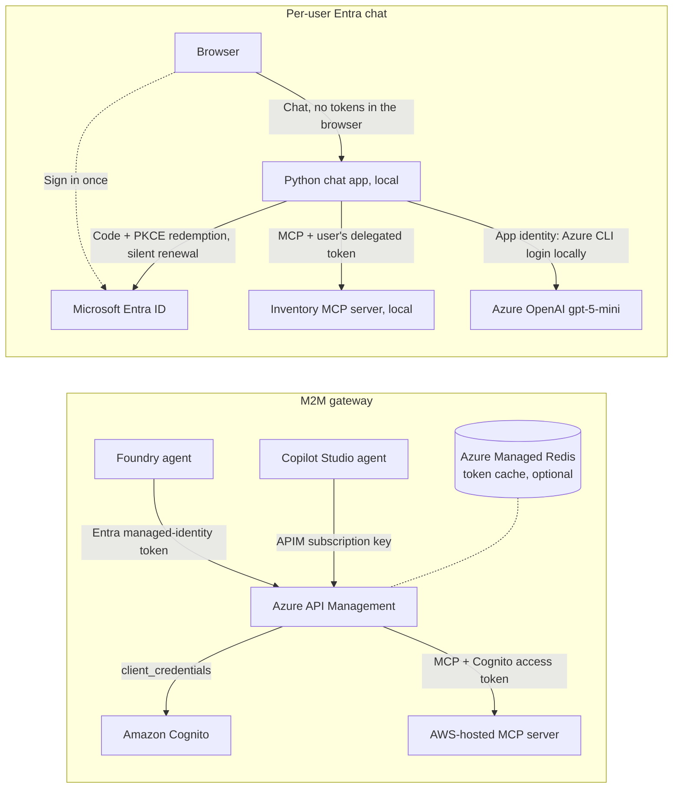

# MCP authentication demos: APIM machine-to-machine and Entra single sign-on

Two companion demos for connecting AI agents to Model Context Protocol (MCP)
servers without static per-user secrets:

| Demo | Pattern | Identity the MCP server sees | Start here |
| --- | --- | --- | --- |
| **Machine-to-machine (M2M) gateway** | Microsoft Foundry and Copilot Studio agents call an AWS-hosted MCP server through Azure API Management (APIM). APIM authenticates the caller, then obtains and caches an Amazon Cognito `client_credentials` token for the AWS hop. | The calling application | [docs/m2m-walkthrough.md](docs/m2m-walkthrough.md) |
| **Per-user Entra chat** | Sign in once with Microsoft Entra ID, then chat. The app calls an MCP server **as you** with a short-lived delegated token that renews silently; `gpt-5-mini` decides when to call the tool. | The signed-in user | [entra-chat-demo/README.md](entra-chat-demo/README.md) |

All inventory data is fictional.

## Architecture



## Repository layout

| Folder | Contents |
| --- | --- |
| [`docs/`](docs) | [M2M walkthrough](docs/m2m-walkthrough.md) (setup, presentation script, failure cases) and [architecture notes](docs/architecture.md) |
| [`m2m-gateway/`](m2m-gateway) | APIM policies; Bicep for the gateway, Redis token cache, and an optional AWS mock; Cognito CloudFormation; Node.js MCP server and Dockerfile; smoke test |
| [`foundry-project/`](foundry-project/README.md) | azd template for the Foundry project and model deployment, plus the agent's evaluation dataset and evaluator |
| [`entra-chat-demo/`](entra-chat-demo/README.md) | Python (Flask) chat app and MCP server, Entra setup and launch scripts, tests, and an azd project (`azd up`, see [Deploy to Azure](entra-chat-demo/README.md#deploy-to-azure-with-azd)) |

## Quick start

### Entra chat demo, deploy to Azure with azd

Requires [Azure Developer CLI (azd)](https://aka.ms/azd), Azure CLI,
PowerShell 7+, and an account that can register Entra applications, create Azure
resources, and assign Azure roles.

Run from the root of this repository, keeping `entra-chat-demo` and
`foundry-project` together (the container build includes the test-question dataset):

```powershell
az login
azd auth login
cd entra-chat-demo
azd up
```

When prompted, choose an environment name, subscription, and region with
`gpt-5-mini` GlobalStandard quota. Open the HTTPS URL printed at completion and
sign in with the account used for setup. No local Docker or Python installation
is needed for this deployment.

This creates billable resources. Remove them and the demo's Entra registrations
by running `azd down --purge` from the same directory. See
[deployment details and configuration](entra-chat-demo/README.md#deploy-to-azure-with-azd)
for permissions, existing-model options, secret rotation, and limitations.

### Entra chat demo, offline (no cloud resources)

Requires Python 3.10 or later. A mock identity provider stands in for Entra,
and an offline responder stands in for the model.

```powershell
cd entra-chat-demo
python -m pip install -r requirements.txt
python run_demo.py
```

Open http://127.0.0.1:9002 and sign in as `alice` / `demo`. The `bob` / `demo`
account lacks the required role and shows the 403 path.

### Entra chat demo, with real Entra sign-in

Requires Windows, PowerShell 7, Python 3.10+, Azure CLI, an Entra account that can
register applications and assign users to them, and access to an Azure OpenAI
chat deployment. See
[entra-chat-demo/README.md](entra-chat-demo/README.md#first-time-setup-or-a-different-environment).

```powershell
cd entra-chat-demo
python -m pip install -r requirements.txt
az login
.\setup_entra.ps1 -SubscriptionId <subscription-id>
.\run_entra.ps1 -ModelEndpoint https://<resource>.openai.azure.com
```

Omit `-ModelEndpoint` if you provisioned [`foundry-project`](foundry-project/README.md)
with azd; the launcher then reads the endpoint from that azd environment.

### M2M gateway

Follow [docs/m2m-walkthrough.md](docs/m2m-walkthrough.md). To exercise the Azure
side before any AWS resources exist:

1. Provision the Foundry project and `gpt-5-mini` deployment (section 7.1).
2. Register the gateway API in Entra (section 7, steps 1-2).
3. Deploy APIM with the demo-only AWS mock (section 6.1), and optionally the
   Redis token cache (section 6.2).
4. Connect the Foundry agent through APIM (sections 7 and 7.1).

Sections 4 and 5 replace the mock with a real Cognito user pool and an
AWS-hosted MCP server.

## Validation status

- **M2M, Azure side:** APIM with the Foundry (Entra) and Copilot (API key)
  routes, the Redis token cache, and a Foundry agent were deployed on
  Consumption-tier APIM and exercised end to end against a demo-only AWS mock
  hosted in APIM. The Copilot route was called from a script.
- **M2M, not exercised:** a real Cognito user pool and AWS-hosted MCP server,
  a Copilot Studio agent (section 8 targets the GitHub Copilot harness
  preview), and Microsoft 365 Copilot (section 8.2 is a documentation review).
- **Entra chat:** verified with real Entra sign-in and an Azure OpenAI
  `gpt-5-mini` deployment. The unit tests and the mock end-to-end flow run
  offline; see [entra-chat-demo/README.md](entra-chat-demo/README.md#offline-mode-and-regression-checks).

Several features used here are in preview and can change.

## Costs, security, and cleanup

- The cloud parts create billable Azure and AWS resources. The Azure Managed
  Redis cache bills for as long as it exists. Clean up with
  [walkthrough section 10](docs/m2m-walkthrough.md#10-failure-cases-and-production-boundaries),
  and [delete the chat demo's two app registrations](entra-chat-demo/README.md#mapping-this-back-to-the-gateway-and-agent-platforms)
  when you no longer need them.
- This is demonstration code, not a production deployment. Each guide lists
  the hardening it would need.
- Local `.azure/`, `.entra/`, and `.env` files hold environment values and
  protected credentials. They are ignored by Git; never commit them.

## License

[MIT](LICENSE). `foundry-project/azure.yaml` and `foundry-project/infra/` come
from Microsoft's MIT-licensed
[azd-ai-starter-basic](https://github.com/Azure-Samples/azd-ai-starter-basic)
template; see [THIRD-PARTY-NOTICES.md](THIRD-PARTY-NOTICES.md).
