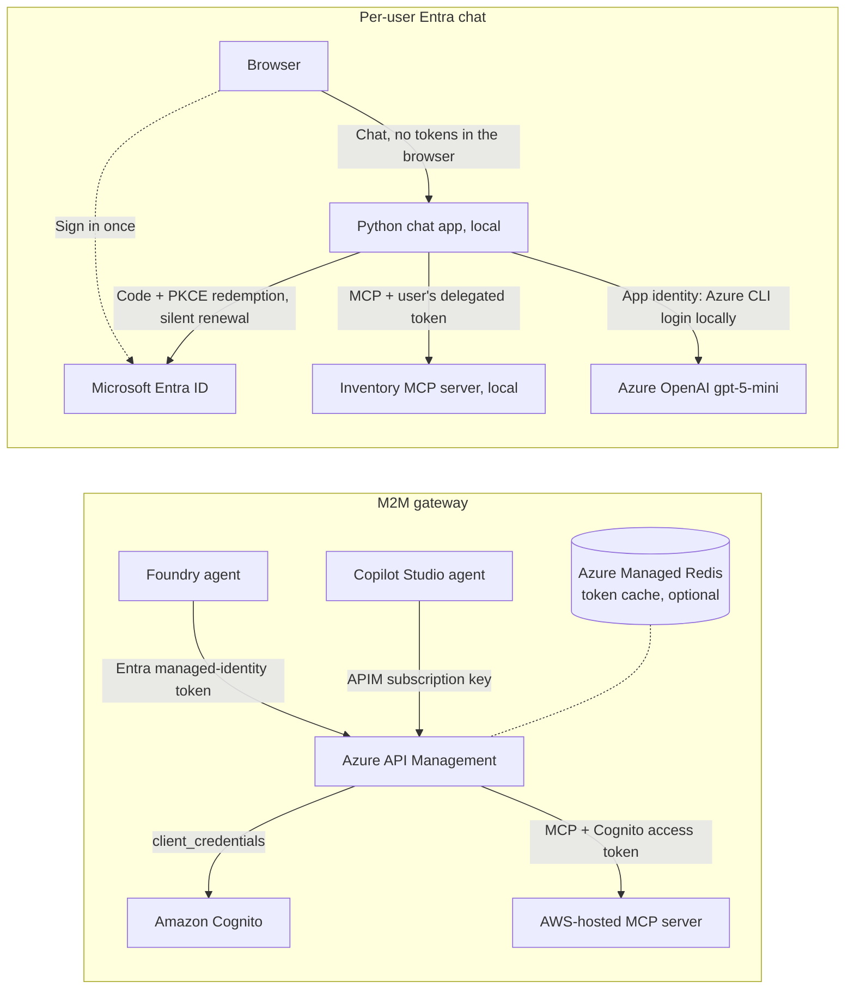

# MCP authentication demos: APIM machine-to-machine and Entra single sign-on

Two companion demos for connecting AI agents to Model Context Protocol (MCP)
servers without static per-user secrets:

| Demo | Pattern | Identity the MCP server sees | Start here |
| --- | --- | --- | --- |
| **Machine-to-machine (M2M) gateway** | Microsoft Foundry and Copilot Studio agents call an AWS-hosted MCP server through Azure API Management (APIM). APIM authenticates the caller, then obtains and caches an Amazon Cognito `client_credentials` token for the AWS hop. | The calling application | [docs/m2m-walkthrough.md](docs/m2m-walkthrough.md) |
| **Per-user Entra chat** | Sign in once with Microsoft Entra ID, then chat. The app calls an MCP server **as you** with a short-lived delegated token that renews silently; `gpt-5-mini` decides when to call the tool. | The signed-in user | [entra-chat-demo/README.md](entra-chat-demo/README.md) |

All inventory data is fictional.

## Architecture



In the [one `azd up` deployment](#deploy-everything-with-one-azd-up), Amazon
Cognito and the AWS-hosted MCP server are a mock that runs inside API Management
(fictional data); nothing is deployed to AWS. To use a real AWS stack, see
[Connecting a real AWS server](#connecting-a-real-aws-server).

## Repository layout

| Folder | Contents |
| --- | --- |
| [`azure.yaml`](azure.yaml), [`infra/`](infra) | One `azd up` for the whole demo: `infra/main.bicep` composes the Azure resources below as modules; the azd hooks manage the Entra registrations, generate the secrets Bicep needs, and create the Foundry agent, all as the signed-in `az` user. See [Deploy everything](#deploy-everything-with-one-azd-up) |
| [`docs/`](docs) | [M2M walkthrough](docs/m2m-walkthrough.md) (setup, presentation script, failure cases) and [architecture notes](docs/architecture.md) |
| [`m2m-gateway/`](m2m-gateway) | APIM policies; Bicep for the gateway, Redis token cache, and an optional AWS mock; Cognito CloudFormation; Node.js MCP server and Dockerfile; smoke test |
| [`foundry-project/`](foundry-project/README.md) | azd template for the Foundry project and model deployment, plus the agent's evaluation dataset and evaluator |
| [`entra-chat-demo/`](entra-chat-demo/README.md) | Python (Flask) chat app and MCP server, Entra setup and launch scripts, tests, and an azd project (`azd up`, see [Deploy to Azure](entra-chat-demo/README.md#deploy-to-azure-with-azd)) |

## Quick start

### Deploy everything with one azd up

`infra/main.bicep` deploys the Azure resources from the repository root into one
resource group, `rg-<environment>`. The root `preup`/`preprovision` and
`postprovision` hooks configure Entra registrations using the same
signed-in-user Graph flow as the standalone chat demo, generate the mock secrets,
and create the Foundry agent. There is no separate permission grant to a
deployment identity, and the template uses no deployment scripts (so it does not
need storage shared-key access). `azd up` also builds the chat app image in Azure
Container Registry and deploys it, so no separate app deployment is needed.

| Area | What is deployed | Declared in |
| --- | --- | --- |
| Foundry | Account, project, `gpt-5-mini` deployment, Application Insights | `foundry-project/infra/core/ai/ai-project.bicep` |
| Gateway | API Management (Consumption), Key Vault, named values, Foundry and Copilot APIs and policies, Copilot Studio subscription | `m2m-gateway/azure-gateway.bicep` |
| AWS stand-in | Mock Cognito token endpoint and mock MCP server inside APIM (fictional data). Nothing is deployed to AWS | same file, `deployMockAws` |
| Token cache | Azure Managed Redis and the APIM external cache | `m2m-gateway/redis-token-cache.bicep`, `apim-external-cache.bicep` |
| Foundry to gateway | Project connection `aws-inventory-mcp` (project managed identity, audience = the gateway API) | `foundry-project/infra/core/ai/connection.bicep` |
| Chat app | Log Analytics, Container Registry, Container Apps environment and app, managed identity, role assignments | `entra-chat-demo/infra/modules/*.bicep` |
| Microsoft Entra ID | Gateway API registration (`Mcp.Invoke` app role, v2 tokens); chat API and chat web registrations; service principals and role assignments | `infra/hooks/preprovision.ps1`, `infra/hooks/postprovision.ps1` |
| Secrets | The chat web app's client secret (created by the Entra hook) and the mock Cognito client secrets (generated by the hook). They reach Bicep as `@secure()` parameters from the azd environment; the gateway module stores the Cognito secrets in Key Vault and the chat app keeps its secret as a Container Apps secret. No secret is a parameter default or a template output | `infra/hooks/preprovision.ps1`, `infra/main.parameters.json` |
| Foundry agent | `aws-inventory-agent`, a prompt agent with the MCP tool. Agents are a Foundry data-plane object that ARM cannot create, so the `postprovision` hook creates it through the project's REST API with your `az` token. An existing agent is left as it is | `infra/hooks/create-agent.ps1` |

The standalone templates in the demo folders are used unchanged, so each demo
still deploys on its own.

#### Prerequisites

- [Azure Developer CLI (azd)](https://aka.ms/azd), Azure CLI, and PowerShell 7+.
- **Owner** (or Contributor plus User Access Administrator) on the subscription;
  the template assigns Azure roles.
- Sign in with `az login` as a user allowed to register applications and assign
  app roles. The hooks use that user's existing Graph permissions and do not
  grant a Graph application permission to the deployment identity. Depending on
  tenant policy, an Entra administrator may need to enable user app registration
  or you may need to activate a directory role (for example in Privileged Identity
  Management, see [Entra permissions](#entra-permissions)); this deployment does
  not request a Global Administrator or Privileged Role Administrator grant.
- A region that supports Foundry, `gpt-5-mini` GlobalStandard (30K TPM quota),
  API Management Consumption, Azure Managed Redis, and Container Apps
  (`swedencentral` was used for the M2M piece).

#### Deploy

Run from the repository root, keeping all folders together (the container build
context is the repository root):

```powershell
az login
azd auth login
azd env new <environment-name> --subscription <subscription-id> --location <region>
azd up
```

Use the same user account for `az login` and `azd auth login`; the Entra hooks use
the Azure CLI user identity. `--subscription` and `--location` are optional: the
`preup` hook runs before azd asks for a subscription, so if `AZURE_SUBSCRIPTION_ID`
is unset it uses the Azure CLI's current subscription (`az account show`) and
prints which one it chose. Pass both so `azd up` has nothing left to ask. The first run creates
the Entra registrations, stores their client IDs and the web client secret in the
azd environment, then deploys the infrastructure and the chat app.

Use a new environment name, not the one used for `entra-chat-demo` on its own;
both create registrations with the same display names. Afterwards:

- Open `WEB_URL` (printed at completion) and sign in to the chat app.
- In the Foundry portal, open `aws-inventory-agent` and ask for `WIDGET-001`.
  Approve the tool call (or see `AGENT_REQUIRE_APPROVAL` below). With the mock,
  the answer is quantity 42 at `ATL-DEMO`.
- For Copilot Studio, see [Copilot Studio](#copilot-studio).

#### Options

Set with `azd env set <NAME> <value>` before `azd up`:

| Variable | Default | Effect |
| --- | --- | --- |
| `APIM_PUBLISHER_EMAIL` | the signed-in user's email | Publisher email that API Management requires. The hook sets it when it is empty |
| `APIM_PUBLISHER_NAME` | `M2M MCP demo` | Publisher name shown in API Management |
| `AGENT_REQUIRE_APPROVAL` | `always` | `never` lets the Foundry agent call the MCP tool without an approval prompt. Applies when the agent is first created |
| `CREATE_AGENT` | `true` | `false` skips agent creation in the `postprovision` hook; create the agent by hand ([walkthrough 7.1](docs/m2m-walkthrough.md#71-scripted-foundry-setup-as-validated)) |
| `AGENT_NAME` | `aws-inventory-agent` | Name of the Foundry agent |
| `ENABLE_TOKEN_CACHE` | `true` | `false` skips Azure Managed Redis; APIM then requests a Cognito token per call |
| `ENABLE_FOUNDRY_MONITORING` | `true` | `false` skips Application Insights and Log Analytics for the Foundry project |
| `AZURE_OPENAI_DEPLOYMENT` | `gpt-5-mini` | Model deployment name shared by the agent and the chat app |
| `OIDC_CLIENT_SECRET` | generated by the Entra hook | Reused until within 14 days of expiry, then rotated |
| `MOCK_FOUNDRY_CLIENT_SECRET`, `MOCK_COPILOT_CLIENT_SECRET` | generated by the hook | The mock Cognito client secrets (64 hex characters). Created once and kept; ignored when `DEPLOY_MOCK_AWS` is `false` |
| `DEPLOY_MOCK_AWS` and `COGNITO_*`, `AWS_MCP_ORIGIN` | mock | See [Connecting a real AWS server](#connecting-a-real-aws-server) |

#### Entra permissions

The Entra setup runs under the identity from `az login`, matching the standalone
chat demo: `preup` (`azd up`) or `preprovision` (`azd provision`) creates or
reuses the registrations, assigns the signed-in user to the app roles, and
creates the chat web app secret; `postprovision` adds the deployed redirect URI
and assigns the Foundry project identity the gateway's `Mcp.Invoke` role. `azd up`
needs the registrations before it reads the Bicep parameters, which is why the
setup runs in `preup`; the `preprovision` run that follows it skips itself for
five minutes after a successful run. No `Application.ReadWrite.OwnedBy` grant or
separate Graph permission step is performed.

A default Entra tenant (users can register applications) needs no directory role
for this. If Graph returns `Authorization_RequestDenied` (403), the tenant
restricts it. Either ask an administrator, or activate **Cloud Application
Administrator** or **Application Administrator** in Privileged Identity
Management (PIM). Global Administrator is not needed. After activating, run
`az logout` and `az login` so the role is in your token, then rerun `azd up`; the
hooks reuse what already exists.

#### Connecting a real AWS server

The default is the mock inside APIM. To point the bridge at a real Amazon Cognito
user pool and AWS-hosted MCP server, deploy those yourself first
([walkthrough sections 4 and 5](docs/m2m-walkthrough.md#4-set-up-aws-authentication):
`m2m-gateway/cognito.yaml` and the server's Dockerfile), then:

```powershell
azd env set DEPLOY_MOCK_AWS false
azd env set COGNITO_TOKEN_URL https://<domain>.auth.<region>.amazoncognito.com/oauth2/token
azd env set COGNITO_FOUNDRY_CLIENT_ID <client-id>
azd env set COGNITO_FOUNDRY_CLIENT_SECRET <client-secret>
azd env set COGNITO_COPILOT_CLIENT_ID <client-id>
azd env set COGNITO_COPILOT_CLIENT_SECRET <client-secret>
azd env set AWS_MCP_ORIGIN https://<your-server-origin>   # without /mcp
azd provision
```

The secrets reach Bicep as secure parameters, and the gateway stores them in Key
Vault. They must be at least 32 characters (Cognito-generated secrets are). The
`preprovision` hook stops early and lists any of the six values you did not set.
The values come from the `cognito.yaml` stack outputs and the Cognito console.

#### Clean up

```powershell
az login   # the postdown hook uses Azure CLI
azd down --purge
```

`--purge` matters because API Management, Key Vault, and Foundry are soft-deleted
and their names are deterministic. `azd down` does not remove Entra objects, so
the `postdown` hook (`infra/hooks/postdown.ps1`) deletes the three registrations
that carry this demo's tag and purges them from the Entra recycle bin, which
otherwise reserves their unique names for 30 days. This creates billable
resources; Azure Managed Redis and the Container Apps environment bill while they
exist.

#### Troubleshooting

| Symptom | Cause and fix |
| --- | --- |
| `Authorization_RequestDenied` or 403 from Graph in `preup`/`preprovision`/`postprovision` | The signed-in `az` user lacks a permission required by the tenant. Activate Cloud Application Administrator or Application Administrator in PIM (or ask an administrator), run `az logout` then `az login`, and rerun `azd up`. See [Entra permissions](#entra-permissions) |
| `preup` used the wrong subscription | The hook defaults to the Azure CLI's current subscription when the environment has none. Run `azd env set AZURE_SUBSCRIPTION_ID <id>` (or `az account set --subscription <id>` before the first run) and rerun. If it already created registrations in the wrong tenant, run `infra/hooks/postdown.ps1` with that environment's values first |
| `AZURE_SUBSCRIPTION_ID is not set and az is not signed in` from the `preup` hook | Run `az login` (the same account as `azd auth login`) and rerun |
| Agent creation fails with 401 or 403 in the `postprovision` hook | Role assignments had not propagated yet. Rerun `azd provision` (or `azd up`); the hook is safe to repeat and leaves an existing agent alone. Or set `CREATE_AGENT=false` and create the agent by hand |
| `TokenCreatedWithOutdatedPolicies` or `InteractionRequired` from Graph in a hook | Continuous access evaluation rejected the cached Azure CLI token, for example after a PIM activation or a policy change. Run `az logout`, then `az login`, and rerun |
| `azd down` stops before the `postdown` hook runs (for example on a network error) | Rerun `azd down --purge`. Or remove the Entra registrations directly: set `AZURE_ENV_NAME` and `AZURE_SUBSCRIPTION_ID`, then run `infra/hooks/postdown.ps1` |
| Name already in use or soft-deleted resource | A previous environment was removed without `--purge`. Purge it or use a new environment name |
| Foundry tool call returns 401 from the mock once after a redeploy | A cached Cognito token was signed with the old mock secret. APIM drops it on the 401; retry |

To deploy only one demo, use the sections below.

### Entra chat demo, deploy to Azure with azd

Requires [Azure Developer CLI (azd)](https://aka.ms/azd), Azure CLI,
PowerShell 7+, and an account that can register Entra applications, create Azure
resources, and assign Azure roles.

Run from the root of this repository, keeping `entra-chat-demo` and
`foundry-project` together (the container build includes the test-question dataset):

```powershell
az login
azd auth login
cd entra-chat-demo
azd up
```

When prompted, choose an environment name, subscription, and region with
`gpt-5-mini` GlobalStandard quota. Open the HTTPS URL printed at completion and
sign in with the account used for setup. No local Docker or Python installation
is needed for this deployment.

This creates billable resources. Remove them and the demo's Entra registrations
by running `azd down --purge` from the same directory. See
[deployment details and configuration](entra-chat-demo/README.md#deploy-to-azure-with-azd)
for permissions, existing-model options, secret rotation, and limitations.

### Entra chat demo, offline (no cloud resources)

Requires Python 3.10 or later. A mock identity provider stands in for Entra,
and an offline responder stands in for the model.

```powershell
cd entra-chat-demo
python -m pip install -r requirements.txt
python run_demo.py
```

Open http://127.0.0.1:9002 and sign in as `alice` / `demo`. The `bob` / `demo`
account lacks the required role and shows the 403 path.

### Entra chat demo, with real Entra sign-in

Requires Windows, PowerShell 7, Python 3.10+, Azure CLI, an Entra account that can
register applications and assign users to them, and access to an Azure OpenAI
chat deployment. See
[entra-chat-demo/README.md](entra-chat-demo/README.md#first-time-setup-or-a-different-environment).

```powershell
cd entra-chat-demo
python -m pip install -r requirements.txt
az login
.\setup_entra.ps1 -SubscriptionId <subscription-id>
.\run_entra.ps1 -ModelEndpoint https://<resource>.openai.azure.com
```

Omit `-ModelEndpoint` if you provisioned [`foundry-project`](foundry-project/README.md)
with azd; the launcher then reads the endpoint from that azd environment.

### M2M gateway

Follow [docs/m2m-walkthrough.md](docs/m2m-walkthrough.md). To exercise the Azure
side before any AWS resources exist:

1. Provision the Foundry project and `gpt-5-mini` deployment (section 7.1).
2. Register the gateway API in Entra (section 7, steps 1-2).
3. Deploy APIM with the demo-only AWS mock (section 6.1), and optionally the
   Redis token cache (section 6.2).
4. Connect the Foundry agent through APIM (sections 7 and 7.1).

Sections 4 and 5 replace the mock with a real Cognito user pool and an
AWS-hosted MCP server.

## Copilot Studio

Copilot Studio is not part of the deployment: it has no Bicep/ARM resource
provider or documented API for agents and tools, so you connect it in the portal.
The deployment creates everything on the Azure side that it needs:

| Wizard field | Value |
| --- | --- |
| Server URL | `APIM_COPILOT_MCP_URL` from `azd env get-values` |
| Authentication | API key, type **Header**, header name `Ocp-Apim-Subscription-Key` |
| Key | Primary key of the APIM subscription named in `APIM_COPILOT_SUBSCRIPTION_NAME` (`copilot-studio-mcp`). Azure portal: API Management > Subscriptions > `copilot-studio-mcp` > Show/hide keys |

APIM checks the key, then does the Cognito `client_credentials` hop with the
Copilot route's own Cognito client, using the same token cache as Foundry. The
full steps, and what was and was not verified, are in
[walkthrough section 8](docs/m2m-walkthrough.md#8-connect-copilot-studio).

**Avoiding the static key.** The Copilot Studio MCP wizard offers three
authentication types: None, API key, and OAuth 2.0 (dynamic discovery, dynamic,
or manual) ([Learn](https://learn.microsoft.com/microsoft-copilot-studio/mcp-add-existing-server-to-agent)).
Every OAuth 2.0 variant is a user sign-in (authorization code) flow; there is no
`client_credentials` option. So the choices are:

| Option | Static secret | User prompt | Identity APIM sees |
| --- | --- | --- | --- |
| APIM subscription key (this demo) | Yes, held by the connection; rotate in APIM | No | The Copilot Studio agent (by key) |
| OAuth 2.0 with Entra, validated in APIM (`validate-azure-ad-token`), APIM still does the Cognito hop | No | Once per user, to sign in and consent | The signed-in user |

Recommendation: keep the subscription key for app-level access, scoped to the one
API and rotated regularly; switch the Copilot route to Entra OAuth when the call
should carry the user's identity. Tenant admin consent for the Entra app removes
the consent part of the first-use prompt, not the sign-in.

## Customer questions and answers

Answers to the follow-up questions from the demo, checked against Microsoft Learn
in November 2026. Product behaviour can change; confirm roadmap questions with your
Microsoft account team.

**1. Is native machine-to-machine authentication to MCP servers supported or
planned for Foundry and Copilot Studio?**
Not as an OAuth `client_credentials` grant to a third-party identity provider such
as Cognito. Foundry's documented MCP authentication methods are key-based,
Microsoft Entra (agent identity or project managed identity), client user
delegation, OAuth identity passthrough, and unauthenticated
([Foundry MCP authentication](https://learn.microsoft.com/azure/foundry/agents/how-to/mcp-authentication)).
Copilot Studio offers None, API key, and user OAuth 2.0 (see
[Copilot Studio](#copilot-studio)). Machine-to-machine therefore works natively
only when the MCP endpoint accepts an Entra token, which is what this demo does:
Foundry presents its project managed-identity token to APIM, and APIM performs the
Cognito `client_credentials` hop. No public roadmap commitment for a native
`client_credentials` option was found.

**2. Can APIM cache the Cognito access token and refresh it on expiry?**
Yes, and the demo does. `m2m-gateway/apim-policy.xml` looks up the token with
`cache-lookup-value` and stores it with `cache-store-value`, keyed by token
endpoint, client ID, and scope, for `expires_in` minus 5 minutes (half the
lifetime for tokens of 10 minutes or less). On expiry the next call fetches a new
token; on a 401 from AWS the policy removes the cached token. API Management
Consumption has no built-in cache, so the deployment adds Azure Managed Redis as an
[external cache](https://learn.microsoft.com/azure/api-management/api-management-howto-cache-external)
(`ENABLE_TOKEN_CACHE`). On tiers with a built-in cache, the same policy works with
`caching-type="internal"`, or with an external cache as here. [Walkthrough section 6.2](docs/m2m-walkthrough.md#62-cognito-token-caching)
has the details.

**3. Can Copilot Studio avoid a static API key?**
Only by using user OAuth 2.0; see [Copilot Studio](#copilot-studio) for the
options and the recommendation.

**4. Example implementation?**
This repository is the sample: one `azd up` deploys APIM, the token cache, the
Foundry project, connection, and agent, the Entra registrations, and the chat
demo. Related Microsoft samples and docs:
[Azure-Samples/AI-Gateway](https://github.com/Azure-Samples/AI-Gateway) (APIM MCP
labs, including `mcp-client-authorization` and `mcp-prm-oauth`),
[foundry-agent-service-remote-mcp-python](https://github.com/Azure-Samples/foundry-agent-service-remote-mcp-python),
[sherpa](https://github.com/Azure-Samples/sherpa),
[Expose an existing MCP server in APIM](https://learn.microsoft.com/azure/api-management/expose-existing-mcp-server),
and [Expose a REST API as an MCP server](https://learn.microsoft.com/azure/api-management/export-rest-mcp-server).

**5. Can Foundry and Copilot Studio pass the user's own token to the MCP server,
without prompting users during the conversation?**
Passing the user's identity: yes.

- **Foundry:** [client user delegation](https://learn.microsoft.com/azure/foundry/agents/how-to/mcp-authentication#microsoft-entra-client-user-delegation)
  forwards the user's Entra token (or an on-behalf-of token, in preview and
  tool-dependent), and
  [OAuth identity passthrough](https://learn.microsoft.com/azure/foundry/agents/how-to/mcp-authentication#oauth-identity-passthrough)
  signs the user in to your own OAuth provider. Users need the Foundry User (or
  Agent Consumer) role. For Entra-protected MCP servers use your own app
  registration (custom OAuth), not the managed Entra option.
- **Copilot Studio:** OAuth 2.0 in the MCP wizard; each user signs in.
- **This repository:** the [Entra chat demo](entra-chat-demo/README.md) shows the
  pattern end to end: sign in once, then the app calls the MCP server with the
  user's short-lived delegated token, renewed silently.

Prompts: there are two different ones.

- **Sign-in and consent** happens once per user (and again only when a refresh
  token is lost or revoked). It cannot be removed entirely, because the platform
  must obtain the user's token. Tenant-wide admin consent removes the consent
  screen; asking for `offline_access` keeps the connection alive silently.
- **Tool approval** ("allow this tool call?") is a separate setting on the agent's
  MCP tool, `require_approval`: `always` (default), `never`, or per tool. Setting
  it to `never` for trusted tools removes the prompt during the conversation. In
  this deployment, `azd env set AGENT_REQUIRE_APPROVAL never` before the agent is
  first created.

With the user's token, the MCP server (or APIM in front of it) sees the actual
user, so per-user authorization and audit work. A non-Entra backend like Cognito
cannot accept an Entra token directly; APIM would validate the user's Entra token
and then either keep the `client_credentials` hop (app identity to AWS, user
identity logged in APIM) or federate Cognito with Entra so the user signs in to
Cognito through Entra.

## Validation status

**Live deployment (November 4–5, 2026):** `azd up --no-prompt` ran against a real
subscription in Sweden Central. The final run started from a new azd environment
with no Azure resources or Entra registrations. It created the Entra
registrations, Azure resources, and Foundry agent, then built and deployed the
chat app, in 12 minutes 51 seconds as reported by azd (about 15 minutes including
the Entra hooks). Azure Managed Redis alone took about 8 minutes. A rerun that
switched the Container App to its existing-app path succeeded in 6 minutes 43
seconds, and a no-change rerun of an earlier environment took 1 minute 32 seconds.
The signed-in user was a regular member with the tenant's default right to
register applications and needed no PIM elevation. The subscription's policy
forbids storage account shared keys, which is why the template uses no deployment
scripts.

Verified on that deployment:

- **Entra:** the hooks created the three registrations, added the chat app's
  redirect URIs, and granted `Mcp.Invoke` to the Foundry project identity; reruns
  reuse them. The chat app answers `/healthz`, and `/login` redirects to the
  tenant with the right client ID, callback, and PKCE. A browser sign-in was not
  exercised in this run.
- **Foundry route:** the hook-created agent was invoked through the Foundry
  Responses API. After the `get_inventory` call was approved, it returned 42
  units at `ATL-DEMO` as `mock-foundry-m2m-client`, through APIM's Entra token
  validation, the mock Cognito token endpoint, and the mock AWS server. Reruns
  leave the agent at version 1.
- **Copilot route:** the subscription-key route returned the same data as
  `mock-copilot-m2m-client`. A wrong key, and a Foundry-route call without a
  token, both returned 401.
- **Redis token cache:** one token per caller is cached for about an hour, and
  repeat calls were served from the cache (the TTLs counted down instead of
  resetting).
- **Defects only the live runs exposed, now fixed:** the APIM external cache
  needs an absolute resource URL (`m2m-gateway/apim-external-cache.bicep`), and
  the Container App module read its own image, which ARM rejects as a circular
  dependency on any rerun. `entra-chat-demo/infra/modules/containerapp.bicep`
  now reads the image and passes it to `containerapp-resource.bicep`; the
  standalone chat demo shared that rerun defect. On a first deployment, API
  Management's system-assigned identity also could not read its Key Vault named
  values because its new role assignment had not propagated yet. The gateway now
  uses a user-assigned identity whose Key Vault role is assigned before API
  Management is created (`m2m-gateway/azure-gateway.bicep`); this also fixes the
  standalone gateway deployment.
- **Cleanup and redeploy:** a transient network timeout interrupted
  `azd down --purge` before its `postdown` hook ran. Running
  `infra/hooks/postdown.ps1` directly then deleted the three registrations and
  purged them from the Entra recycle bin, and a fresh `azd up` with the same
  environment name succeeded.
- **Not exercised:** a real Cognito user pool and AWS-hosted MCP server, a
  Copilot Studio agent (section 8 targets the GitHub Copilot harness preview),
  Microsoft 365 Copilot (section 8.2 is a documentation review), and a browser
  sign-in to the deployed chat app. If a step fails, the manual route in the
  walkthrough (sections 6.1, 7, and 7.1) still applies.
- **Entra chat:** verified with real Entra sign-in and an Azure OpenAI
  `gpt-5-mini` deployment. The unit tests and the mock end-to-end flow run
  offline; see [entra-chat-demo/README.md](entra-chat-demo/README.md#offline-mode-and-regression-checks).

Several features used here are in preview and can change.

## Costs, security, and cleanup

- The one-command deployment creates billable Azure resources. The manual M2M
  route can additionally create AWS resources. The Azure Managed
  Redis cache bills for as long as it exists. For the one `azd up` deployment,
  see [Clean up](#clean-up). For the manual route, clean up with
  [walkthrough section 10](docs/m2m-walkthrough.md#10-failure-cases-and-production-boundaries),
  and [delete the chat demo's two app registrations](entra-chat-demo/README.md#mapping-this-back-to-the-gateway-and-agent-platforms)
  when you no longer need them.
- This is demonstration code, not a production deployment. Each guide lists
  the hardening it would need.
- Local `.azure/`, `.entra/`, and `.env` files hold environment values and
  protected credentials. They are ignored by Git; never commit them.

## License

[MIT](LICENSE). `foundry-project/azure.yaml` and `foundry-project/infra/` come
from Microsoft's MIT-licensed
[azd-ai-starter-basic](https://github.com/Azure-Samples/azd-ai-starter-basic)
template; see [THIRD-PARTY-NOTICES.md](THIRD-PARTY-NOTICES.md).
