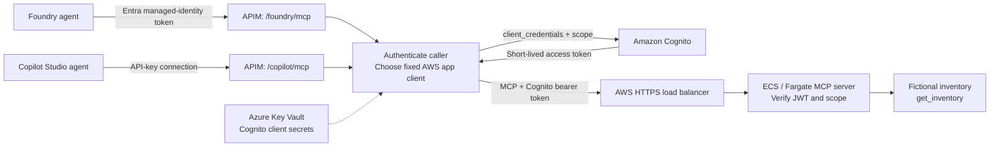
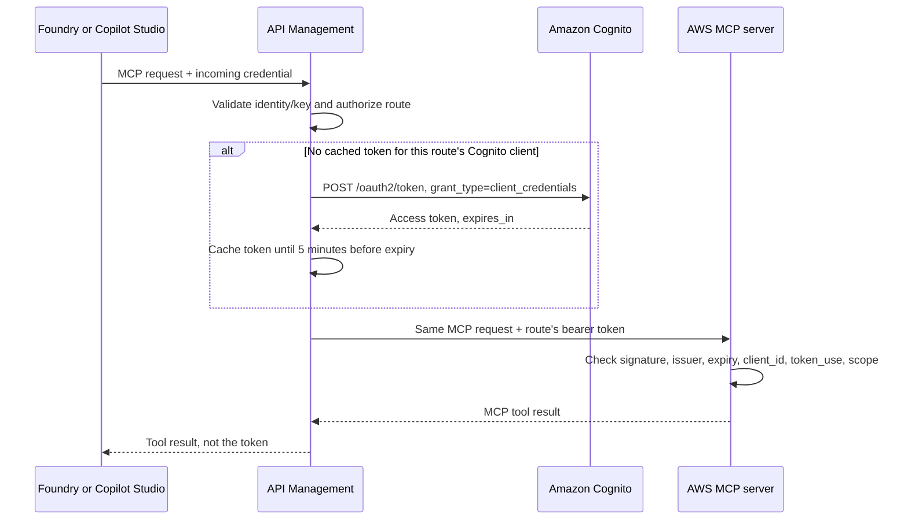

# Demo: M2M authentication to AWS-hosted MCP servers

**From Azure AI Foundry / Microsoft Foundry and Microsoft Copilot Studio**

This walkthrough shows how to connect two Microsoft agent platforms to one
AWS-hosted Model Context Protocol (MCP) server without asking each user to sign
in to AWS. The example tool returns **fictional inventory data**.

**This is an architecture and setup demo, not a turnkey deployment.** The
companion files show the important implementation pieces.

**Validation status.** The Azure side (APIM gateway, Azure Managed Redis token
cache, and a Foundry agent) was deployed on Consumption-tier APIM and exercised
end to end against a demo-only AWS mock (sections 6.1, 6.2, and 7.1). The Redis
TLS/access-key connection and APIM cache policy were verified with read-only
MCP calls against the APIM-hosted mock; repeated requests reused the same
cached Cognito token. The Copilot Studio route was exercised with its API key
from a script; no Copilot Studio agent was configured. Section 8 targets the
GitHub Copilot harness MCP preview, and section 8.2 summarizes Microsoft 365
Copilot options from documentation; neither was exercised. A real Cognito user
pool and AWS-hosted MCP server have not been provisioned or exercised. Product
documentation was reviewed on November 3, 2026; preview features, tenant UI,
and availability can differ.

The one-`azd up` route in the [root README](../README.md#deploy-everything-with-one-azd-up)
automates sections 6.1, 6.2, 7, and 7.1 against the same mock. It compiles and
passes ARM preflight validation but has not yet been deployed end to end.
For a separate **per-user Entra OAuth chat demo**, see
[`entra-chat-demo\README.md`](../entra-chat-demo/README.md). You sign in once through real Entra
app registrations, then ask questions in a chat UI; `gpt-5-mini` answers by
calling a local MCP API with your delegated token, which renews silently. It
does not replace or reconfigure this walkthrough's APIM/Cognito M2M routes.

## 1. The story to tell

> "Our inventory tools run in AWS. Foundry and Copilot Studio both call those
> tools, but neither needs an AWS user's credentials. A gateway authenticates
> each caller, obtains an application access token from Amazon Cognito, and
> forwards the MCP request. The AWS server checks the token and its permission
> before executing the tool."

The important distinction is **which identity authenticates each hop**:

| Hop | Authentication in this demo | What it represents |
| --- | --- | --- |
| Foundry -> Azure API Management (APIM) | Microsoft Entra token from the Foundry project's managed identity | App-to-app, no stored client secret |
| Copilot Studio GitHub Copilot harness -> APIM | API key configured for the MCP server connection | Gateway credential, **not the Cognito OAuth client-credentials exchange** |
| APIM -> Amazon Cognito | OAuth 2.0 `client_credentials`, using a confidential app client | Actual OAuth M2M token acquisition |
| APIM -> AWS MCP server | Cognito access token in `Authorization: Bearer ...` | Application identity plus an allowed scope |
| AWS MCP server -> AWS services, if added later | ECS task IAM role | Separate AWS workload authorization |

**Why use a gateway?** Foundry supports identity-based MCP authentication.
The GitHub Copilot harness documentation describes adding a custom MCP server
and configuring its authentication, including API-key credentials. It does not
specify whether direct OAuth `client_credentials` authentication to Cognito is
supported. Separately, Power Platform documents that generic custom-connector
OAuth does not support the `client_credentials` grant; that limitation should
not be generalized to the GitHub Copilot harness MCP connection. This demo uses
an API key from Copilot Studio to APIM and has APIM obtain the Cognito token.
See [1], [3], [15], [16].

This is therefore **OAuth M2M on the AWS hop**, with managed identity or a
shared key on the incoming hop. It is not end-to-end secretless authentication,
user delegation, or Entra-to-AWS workload identity federation. The Copilot
Studio MCP setup is a preview and has not been tested with a live agent.

## 2. Architecture



Use two Cognito app clients: `mcp-foundry-gateway` and
`mcp-copilot-gateway`. The server can distinguish the originating integration
by the verified `client_id`, even though both calls pass through APIM.



The gateway uses its **own, independent token**, reused per route until shortly
before it expires (section 6.2). It does not forward the incoming Entra token
to Cognito, perform on-behalf-of exchange, or forward the
Copilot API key to AWS.

## 3. What is included

Paths are relative to the repository root, and the commands in this walkthrough
run from there unless a step changes directory.

| File | Purpose |
| --- | --- |
| `m2m-gateway\cognito.yaml` | CloudFormation example: user pool, OAuth domain, resource scope, two confidential app clients |
| `m2m-gateway\apim-policy.xml` | Incoming auth, route-to-client mapping, Cognito token acquisition and caching, MCP forwarding |
| `m2m-gateway\server.mjs` | Small JWT-protected, read-only MCP server |
| `m2m-gateway\package.json`, `m2m-gateway\package-lock.json` | Node.js dependencies, locked versions, and start command |
| `m2m-gateway\Dockerfile` | Container packaging for the AWS server |
| `m2m-gateway\smoke.ps1` | Direct Cognito M2M request followed by a real MCP handshake and tool call |
| `m2m-gateway\azure-gateway.bicep` | One-step Azure deployment of section 6: APIM, Key Vault, named values, both APIs, Copilot subscription, optional AWS mock |
| `m2m-gateway\redis-token-cache.bicep` | Azure Managed Redis cache and database for Consumption APIM token caching |
| `m2m-gateway\apim-external-cache.bicep` | Registers Redis as APIM's external cache and applies the cache policy to both routes |
| `m2m-gateway\apim-mock-aws-policy.xml` | Demo-only APIM mock of the Cognito token endpoint and the AWS MCP server (fictional data) |
| `foundry-project\` | Copy of the `azd-ai-starter-basic` template [14] used for the section 7.1 Foundry project, plus the agent's evaluation dataset and evaluator |
| `azure.yaml`, `infra\main.bicep` | One `azd up` deploys the Azure resources in Bicep; the hooks manage the Entra registrations and the secrets Bicep needs, and create the Foundry agent, all using the signed-in `az` user (see the README's "Deploy everything with one azd up"). The sections below remain the manual route |
| `infra\modules\*.bicep` | Modules for the unified deployment: gateway and Redis wiring, Redis connection string, and Foundry project identity |
| `infra\hooks\*.ps1` | Root azd hooks create or update the three Entra registrations and app-role assignments using the signed-in user, generate the mock Cognito secrets, set the deployed redirect URI, create the section 7.1 Foundry agent, and clean up those registrations on `azd down` |

To present without deploying anything, use the diagrams, configuration tables,
policy file, and illustrative result in section 9. There is no need to enter
real credentials for that walkthrough. To show the Azure side live before the
AWS stack exists, use sections 6.1 and 7.1.

## 4. Set up AWS authentication

You need an AWS account with permission to create Cognito and container-hosting
resources. Running this in a real account incurs AWS charges, including Cognito
M2M usage; Azure resources also have separate charges.

In a commercial AWS region such as `us-east-1`, upload `m2m-gateway\cognito.yaml`
to CloudFormation and supply a unique Cognito domain prefix. Alternatively,
configure these same settings in Cognito:

| Setting | Demo value |
| --- | --- |
| Resource server identifier | `mcp-demo` |
| Scope name | `inventory.read` |
| Complete OAuth scope | `mcp-demo/inventory.read` |
| App clients | `mcp-foundry-gateway`, `mcp-copilot-gateway` |
| Client secret | Generated separately for each app client |
| Allowed OAuth grant | Client credentials only |
| Allowed OAuth scope | `mcp-demo/inventory.read` |
| Access token lifetime | 15 minutes |

Record the stack outputs: user pool ID, app client IDs, token endpoint, and
issuer. Obtain each generated secret through the authorized Cognito
administration interface and put it in **Azure Key Vault**. The template does
not output secrets.

The wire-level exchange looks like this; this is illustrative HTTP, not a
command to paste:

```http
POST https://<domain>.auth.<region>.amazoncognito.com/oauth2/token
Authorization: Basic <base64(client_id:client_secret)>
Content-Type: application/x-www-form-urlencoded

grant_type=client_credentials&scope=mcp-demo%2Finventory.read
```

Illustrative response:

```json
{
  "access_token": "<short-lived JWT; never display or log>",
  "token_type": "Bearer",
  "expires_in": 900
}
```

Client credentials returns an **access token, not a refresh token**. Obtain a
new access token when needed. The token endpoint's custom domain is not the
JWT issuer: use the user pool issuer and its JWKS when verifying tokens. [5]

## 5. Host the MCP server in AWS

The companion server exposes:

```text
GET  /healthz    Container/load-balancer health check
POST /mcp       Authenticated MCP Streamable HTTP
```

It uses stateless Streamable HTTP with JSON responses, not the deprecated
`/sse` transport. Each MCP HTTP request is authenticated, including
initialization and tool discovery. This demo deliberately has no persistent
MCP sessions, subscriptions, browser OAuth discovery, or dynamic client
registration.

Example task environment:

```text
COGNITO_USER_POOL_ID=<UserPoolId output>
COGNITO_CLIENT_IDS=<FoundryClientId output>,<CopilotClientId output>
MCP_PUBLIC_URL=https://mcp.aws.example.com
PORT=8080
```

There are **no Cognito client secrets on the MCP server**. It only needs public
verification keys and an allowlist of app client IDs.

For a real deployment, build `m2m-gateway\Dockerfile`, push the image to Amazon
ECR, and run it as an ECS Fargate service behind an HTTPS Application Load
Balancer (ALB). Point an ACM-backed custom DNS name at the ALB. Configure
`/healthz` as the target-group health check. Permit the ALB to reach the
container's port 8080; do not expose the task directly to the internet.

Use the ALB for TLS termination and routing. **Do not enable the ALB's
interactive Cognito sign-in action** for this M2M endpoint; the application's
JWT middleware does the authorization. Ensure the container can fetch the
user pool's HTTPS JWKS endpoint.

The server verifies the signature, issuer, expiration, `token_use=access`,
allowlisted `client_id`, and exact `mcp-demo/inventory.read` scope. These
ordinary Cognito M2M tokens do not require an `aud` claim: Cognito's access-token
client check uses `client_id`, unlike an ID token's `aud`. If you introduce
resource-bound tokens, also enforce the intended audience. Do not disable
audience checks generically for other token providers. [6]

An eventual DynamoDB/S3 integration would use the **ECS task role**, with
least-privilege IAM permissions. A Cognito token is not an AWS access key and
cannot replace SigV4 authentication for AWS APIs.

## 6. Configure the APIM bridge

This example uses **ordinary APIM HTTP APIs as a transparent MCP proxy**. Do
not convert individual REST operations into new MCP tools; the AWS server
already implements MCP. APIM also has native existing-MCP-server onboarding,
but that is not required for this example. [4]

Create these two HTTP APIs, each with `POST`, `GET`, and `DELETE` operations
at `/mcp`. GET/DELETE reach the demo server and return 405 because it is
stateless.

| APIM setting | Foundry route | Copilot route |
| --- | --- | --- |
| API identifier, not display name | `foundry-mcp` | `copilot-mcp` |
| API URL suffix | `foundry` | `copilot` |
| Incoming MCP URL | `https://<apim>.azure-api.net/foundry/mcp` | `https://<apim>.azure-api.net/copilot/mcp` |
| Subscription required | No; the policy requires Entra auth | **Yes** |
| Web service URL | `https://mcp.aws.example.com` | `https://mcp.aws.example.com` |

Create an **API-scoped subscription for only `copilot-mcp`**. Record both its
subscription identifier and a key; these are different values. Do not use the
built-in all-access subscription or share this key with Foundry.

Create the following APIM named values before applying the policy:

| Named value | Value |
| --- | --- |
| `entra-tenant-id` | Foundry project's Entra tenant ID |
| `entra-api-client-id` | Application/client GUID of the gateway API registration in section 7 |
| `foundry-principal-id` | Object/principal ID of the Foundry project's managed identity |
| `copilot-subscription-id` | Identifier of the approved API-scoped APIM subscription, **not its key** |
| `cognito-token-url` | Cognito `TokenEndpoint` stack output |
| `cognito-foundry-client-id` | Cognito `FoundryClientId` output |
| `cognito-foundry-client-secret` | Secret named value backed by Key Vault |
| `cognito-copilot-client-id` | Cognito `CopilotClientId` output |
| `cognito-copilot-client-secret` | Secret named value backed by Key Vault |
| `aws-mcp-origin` | `https://mcp.aws.example.com`, without `/mcp` |

Enable APIM's managed identity and give it permission to read only the required
Key Vault secrets. APIM's managed identity is **not** the Foundry project's
managed identity. Follow the Key Vault named-value setup guidance in [7].

Apply `m2m-gateway\apim-policy.xml` at **All operations** on each API. The same
policy chooses credentials based on the trusted APIM API identifier, never a
caller-supplied client ID, scope, or destination URL.

The policy validates the incoming credential **before** requesting a Cognito
token. It overwrites `Authorization`, strips the APIM subscription credential,
rewrites the path to `/mcp`, and preserves the MCP body and protocol headers.
Keep response buffering and body logging disabled.

**Token caching:** the policy reuses each route's Cognito token until shortly
before it expires instead of requesting one per HTTP request; see section 6.2.
Do not cache MCP tool results as a substitute for caching credentials.

### 6.1 Deploy the Azure side with Bicep (optional AWS mock)

> The root `azd up` ([README](../README.md#deploy-everything-with-one-azd-up))
> runs this APIM deployment and section 6.2. The preprovision hook creates the
> Entra registrations using the signed-in `az` user. The steps below are the
> manual route.

`m2m-gateway\azure-gateway.bicep` deploys this section in one step. It creates an
APIM Consumption instance with a managed identity, a Key Vault holding the two
Cognito client secrets, the named values above, both APIs with
`apim-policy.xml`, and the `copilot-studio-mcp` subscription. Register the
gateway API in Entra first (section 7, steps 1-2), because the template needs
its client GUID.

```powershell
az group create -n rg-m2mmcp -l swedencentral
# Demo secrets are generated in the session; they are never typed or displayed.
$foundrySecret = [guid]::NewGuid().ToString('N') + [guid]::NewGuid().ToString('N')
$copilotSecret = [guid]::NewGuid().ToString('N') + [guid]::NewGuid().ToString('N')
az deployment group create -g rg-m2mmcp -f .\m2m-gateway\azure-gateway.bicep -p `
  publisherEmail=<you@contoso.com> `
  entraApiClientId=<gateway API client GUID> `
  foundryPrincipalId=<Foundry project managed-identity principal ID> `
  deployMockAws=true `
  cognitoFoundryClientId=mock-foundry-m2m-client cognitoFoundryClientSecret=$foundrySecret `
  cognitoCopilotClientId=mock-copilot-m2m-client cognitoCopilotClientSecret=$copilotSecret
```

`deployMockAws=true` adds a `mock-aws` API (`m2m-gateway\apim-mock-aws-policy.xml`)
to the same APIM instance and points `cognito-token-url` and `aws-mcp-origin`
at it. The mock imitates the Cognito client-credentials endpoint and a
stateless MCP server with the same `get_inventory` tool and fictional data. It
signs its tokens with the per-client secrets from Key Vault, so only the
gateway can call it. `apim-policy.xml` is unchanged, so every Azure-side hop
really runs: incoming Entra or API-key validation, a client-credentials request
with the route's own Cognito client, and MCP forwarding. Each tool result
includes `cognitoClientId`, showing which Cognito client reached the backend.
The mock is neither Cognito nor AWS, so it tests nothing on the AWS side.

Quick checks that should all return **401**: `/foundry/mcp` without an Entra
token, `/copilot/mcp` without a key or with a wrong key, and `/mock-aws/mcp`
without a gateway-issued token.

When the AWS stack exists, redeploy with `deployMockAws=false` and the real
`cognitoTokenUrl`, `awsMcpOrigin`, client IDs, and client secrets. Then refresh
the two Key Vault-backed named values in APIM so the new secret versions take
effect immediately. Delete the `mock-aws` API afterward; an incremental
redeploy leaves it in place.

### 6.2 Cognito token caching

Without caching, every MCP HTTP request would cost a Cognito token request.
`apim-policy.xml` keeps one token per route and reuses it:

- **Key:** token endpoint, the route's Cognito client ID, and scope. All three
  come from named values or the policy itself, never from the caller, so the
  Foundry and Copilot routes never share a token.
- **Lifetime:** `cache-store-value` keeps the token until 5 minutes before
  `expires_in`, or for half its lifetime if it is valid for 10 minutes or
  less. [29]
- **Rejection:** if AWS returns 401, the outbound section removes the entry so
  the next request fetches a fresh token.
- **Cache store:** classic and v2 tiers use the built-in cache. The
  **Consumption** tier has no built-in cache; configure an external
  Redis-compatible cache such as Azure Managed Redis. Without one, expect
  lookups to miss and every request to fetch a token, as before; cache
  operations are best effort and do not fail the request. [28], [30]

An external cache holds live AWS bearer tokens. APIM connects to Azure Managed
Redis with an access-key connection string, not Entra authentication. [30]
Restrict cache network access wherever the gateway networking model allows,
and protect the access key like any other secret.
A cached token stays in use until its entry expires, even after you rotate the
Cognito client secret; to cut off a client immediately, remove its client ID
from the MCP server's allowlist. Requests that miss at the same moment may each
fetch a token, which is harmless.

To confirm caching on a tier with a cache, trace two calls in a row; the second
should show no `send-request` to Cognito.

The validated Consumption-tier setup used Azure Managed Redis in the same
region as APIM. Its endpoint was public because Consumption-tier APIM has no
VNet connectivity; Redis access-key authentication and TLS were enabled. The
smallest Balanced B0 SKU is enough for this demo but incurs ongoing Azure
charges. For production, use a private networking design and a cache size
selected for the workload.

To provision the cache, deploy `m2m-gateway\redis-token-cache.bicep` to the demo
resource group. The template creates the B0 cluster and encrypted database with
access-key authentication enabled. Retrieve its primary key through the Azure
portal or the `Microsoft.Cache/redisEnterprise/databases/listKeys` management
action; do not print or commit the key. Form the TLS connection string as
`<redis-fqdn>:10000,password=<primary-key>,ssl=True,abortConnect=False` and
provide it as the secure `redisConnectionString` parameter to
`m2m-gateway\apim-external-cache.bicep`, together with the APIM name and Redis
resource ID. That template registers the cache and applies the updated
`m2m-gateway\apim-policy.xml` to **All operations** on both APIs; the three token
cache operations explicitly select the external store.

**Alternative without caching code:** APIM credential manager can hold a
Generic OAuth 2.0 connection that uses the client-credentials grant, read at
runtime with the `get-authorization-context` policy. Classic and v2 tiers cache
that token until 3 minutes before expiry; Consumption does not cache it, and
each connection allows 250 token requests per minute. [31] Generic providers
support client credentials depending on the provider; this was not tried with
Cognito. [32]

## 7. Connect Azure AI Foundry / Microsoft Foundry

Use a Foundry project with an enabled managed identity, a model deployment,
and an agent. Use the project identity here for a straightforward demonstration;
agent-scoped identity is an alternative where supported. [1]

> With root `azd up`, the preprovision hook creates the gateway app registration,
> and the postprovision hook grants `Mcp.Invoke` to the Foundry project identity.
> Bicep creates the project connection and the postprovision hook creates the
> agent through the project's REST API. Set `AGENT_REQUIRE_APPROVAL=never` before
> the agent is first created to skip tool-approval prompts.

1. Register a single-tenant Microsoft Entra application representing the APIM
   gateway API. Set its Application ID URI to `api://<application-client-GUID>`.
   Configure `api.requestedAccessTokenVersion` to `2`.
2. Define an app role `Mcp.Invoke` with **Applications** as the allowed member
   type. Assign that role on the API's service principal to the Foundry
   project's managed identity. This is an Entra **app-role assignment**, not
   an Azure subscription Contributor/Reader role.
3. Set the APIM named values from section 6. For v2 access tokens, the expected
   `aud` is the API's application/client GUID; `oid` must match the Foundry
   project's managed-identity principal ID.
4. Create an identity-based remote MCP project connection, then attach it to
   the agent. Use the portal if those controls are available, or the official
   connection-creation instructions in [1]. The settings to map are:

| Connection setting | Value |
| --- | --- |
| Target/server URL | `https://<apim>.azure-api.net/foundry/mcp` |
| Authentication | Project managed identity |
| Resource/audience to request | `api://<application-client-GUID>` |
| MCP server label | `aws_inventory` |
| Allowed tool | `get_inventory` |
| Approval | Keep approval enabled for the walkthrough |

The connection's requested resource and the token's `aud` are related but are
not necessarily identical strings; the v2-token setup above is deliberate.
The project connection manages token acquisition. Do **not** paste a
short-lived token into an API-key connection and describe that as automatic
M2M renewal.

Ask the agent:

> Use the AWS inventory tool to check WIDGET-001. Tell me the quantity and
> warehouse. Do not invent a result if the tool fails.

Approve the tool call if prompted. Approval is a tool-execution control, not
an OAuth sign-in.

**Possible direct variant:** Foundry can call an AWS-hosted MCP server directly
if that server validates the expected Entra application tokens and app roles.
AWS hosting does not require Cognito. This demo keeps Cognito and APIM to show
one AWS trust model shared by both client platforms.

### 7.1 Scripted Foundry setup (as validated)

The validated setup used a public Foundry project from the
`azd-ai-starter-basic` template [14] with a `gpt-5-mini` deployment. The
[`foundry-project\`](../foundry-project/README.md) folder contains that
template, which deploys no model unless `AI_PROJECT_DEPLOYMENTS` is set:

```powershell
cd foundry-project
azd env new m2mmcp --location swedencentral --subscription <subscription-id>
azd env set AI_PROJECT_DEPLOYMENTS '[{"name":"gpt-5-mini","model":{"name":"gpt-5-mini","format":"OpenAI","version":"2025-08-07"},"sku":{"name":"GlobalStandard","capacity":50}}]'
azd provision
cd ..
```

To start from the upstream template instead, run
`azd init -t https://github.com/Azure-Samples/azd-ai-starter-basic -e m2mmcp`
in an empty folder, then set the same deployment before `azd provision`.

The portal cannot assign app roles to a managed identity, so assign
`Mcp.Invoke` through Microsoft Graph:

```powershell
$sp = '<gateway API service principal object ID>'
@{ principalId = '<project managed-identity principal ID>'; resourceId = $sp; appRoleId = '<Mcp.Invoke app role ID>' } |
  ConvertTo-Json | Set-Content -Path .\role.json
az rest --method post --url "https://graph.microsoft.com/v1.0/servicePrincipals/$sp/appRoleAssignedTo" --body "@role.json"
Remove-Item .\role.json
```

Create the managed-identity MCP connection [13]:

```powershell
azd ai connection create aws-inventory-mcp --kind remote-tool `
  --target https://<apim>.azure-api.net/foundry/mcp `
  --auth-type project-managed-identity `
  --audience api://<gateway API client GUID> `
  -p https://<account>.services.ai.azure.com/api/projects/<project>
```

Create the prompt agent with the Foundry REST API [13], using a bearer token
for `https://ai.azure.com`:

```http
POST https://<account>.services.ai.azure.com/api/projects/<project>/agents?api-version=v1

{
  "name": "aws-inventory-agent",
  "definition": {
    "kind": "prompt",
    "model": "gpt-5-mini",
    "instructions": "You answer inventory questions for a machine-to-machine (M2M) authentication demo.\nUse the aws_inventory MCP tool get_inventory to look up a SKU. Report the quantity and warehouse exactly as the tool returns them, and mention the cognitoClientId the AWS side saw when it is present.\nIf the tool fails or returns an error, say so plainly. Never invent inventory data. All data is fictional demo data.",
    "tools": [{
      "type": "mcp",
      "server_label": "aws_inventory",
      "server_url": "https://<apim>.azure-api.net/foundry/mcp",
      "allowed_tools": ["get_inventory"],
      "require_approval": "always",
      "project_connection_id": "aws-inventory-mcp"
    }]
  }
}
```

Test it in the Foundry playground, or create a conversation and response at
`.../agents/aws-inventory-agent/endpoint/protocols/openai` and send an
`mcp_approval_response` for the `mcp_approval_request`. With the section 6.1
mock, the agent reports quantity 42 at `ATL-DEMO` and
`cognitoClientId: mock-foundry-m2m-client`.

## 8. Connect Copilot Studio

Use an agent created with the **GitHub Copilot harness**. MCP support for this
harness is in preview. This demo's server uses Streamable HTTP (section 5).
The GitHub Copilot harness preview documentation doesn't specify its supported
MCP transports, so verify that the server handshake works in your tenant before
presenting this as a tested integration. [2], [15], [16]

1. Open the agent's **Build** tab, select **Tools**, then **Add tool**. In the
   **Add a tool** dialog, select **Add** next to the search bar and choose
   **Model Context Protocol (MCP)**.
2. Enter a short name such as `AWS Inventory`, a description such as "Read
   fictional stock quantities from our AWS inventory MCP server," and
   `https://<apim>.azure-api.net/copilot/mcp` as the server URL.
3. If offered, configure API-key authentication for a **Header** named
   `Ocp-Apim-Subscription-Key`. Use the approved API-scoped APIM subscription's
   **key value**, not its identifier. If the preview UI doesn't expose this
   configuration, stop and validate the supported authentication options for
   your tenant rather than substituting an unverified OAuth flow.
4. Select **Add**, review the tools discovered from the server, and save. Check
   that `get_inventory` is available and enabled for the agent.
5. In **Preview**, ask the same WIDGET-001 question. Use the activity trace to
   confirm that the MCP tool was invoked and inspect its result.

The GitHub Copilot harness MCP documentation describes server credentials,
including API keys, but does not specify a maker-provided versus end-user
credential mode for this connection. The shared-key behavior must therefore be
confirmed in the tenant and again in the published channel before claiming that
users won't be prompted for the gateway key. Users may still need to
authenticate to the published agent. An organization policy can also block the
MCP server. [15], [17]

Only APIM stores the Cognito secret and performs `client_credentials`.
Keep the APIM key in the MCP server's configured credentials; never put it in
agent instructions, prompts, or tool arguments.

### 8.1 Entra service-principal alternative: not verified for this harness

The Entra service-principal/custom-connector procedure described in some
Power Platform material is a separate connector flow; it is not the GitHub
Copilot harness MCP setup documented above. Neither the new-harness MCP
instructions nor the general preview announcement establishes that this
custom-connector authentication option works for GitHub Copilot harness agents.
Do not present it as a supported alternative for this demo without verifying it
in the target tenant. The general custom-connector documentation's
`client_credentials` limitation applies to custom connectors, not necessarily
to the new-harness MCP connection. An unofficial walkthrough is not evidence
that this flow is supported by the new harness. [3], [11], [12], [15], [16]

### 8.2 Microsoft 365 Copilot: what carries over (documentation review)

Microsoft 365 Copilot has no machine-to-machine option of its own. Plugin
authentication is described as obtaining and sending credentials "on behalf of
the signed-in user," and the supported schemes (Entra single sign-on, OAuth 2.0
authorization code, dynamic client registration, API key, anonymous) include no
`client_credentials` option. MCP plugins used as declarative-agent actions also
don't support API keys. The APIM bridge therefore still carries the AWS hop.
[18], [19]

None of these routes was run. Test each one as an end user in the published
channel before presenting it as working.

- **Foundry agent published to Microsoft 365 Copilot or Teams (closest fit).**
  Publishing creates an Azure Bot Service resource and exposes the agent in
  both places. Use the **Just you** scope for a demo; it needs no admin
  approval, but publishing needs the Azure Bot Service Contributor role and the
  `Microsoft.BotService` provider. Foundry's identity guidance says a tool
  connection that uses project managed identity authentication is granted
  access through that identity, so `/foundry/mcp` and its `oid` check should be
  unchanged. Verify that APIM still sees the project identity after
  publishing. MCP approvals are handled in the conversation. [20], [21], [22]
- **Copilot Studio agent in the Microsoft 365 channel.** Publish the agent at
  least once, connect the Microsoft 365 and Microsoft Teams channel, and select
  **Make agent available in Microsoft Copilot**; otherwise the agent is
  available only in Teams. The overview lists M365 / Teams as supported for
  both harnesses. The API-key connection to `/copilot/mcp` carries over, but
  users may be asked for the gateway key: the standard harness defaults to
  **End user** credentials and offers **Maker-provided**, the GitHub Copilot
  harness doesn't specify a mode, and per-user connections are saved for each
  agent **and each channel**. Test the first-run experience in Teams and
  Microsoft Copilot. [2], [8], [16], [23], [24], [25]
- **Native Microsoft 365 plugin with Entra single sign-on.** A declarative agent
  with an MCP plugin can use Entra SSO. Add a third APIM route that validates
  the signed-in user's Entra token, and keep the same Cognito
  `client_credentials` exchange toward AWS. This is a design inference from the
  documented flow, and it isn't in the example files. The first hop becomes
  user-delegated, not M2M. [18], [26]
- **API plugin with an API key.** API-key authentication is documented only for
  API plugins built from an OpenAPI document; the key can travel as a bearer
  token, a custom header, or a query parameter. It would need an OpenAPI
  description of a gateway operation that wraps the MCP call, which this demo
  doesn't provide. [19]

The Microsoft 365 app manifest's `agentConnectors` array can reference a remote
MCP server, and its authorization schema lists `ApiKeyPluginVault`. The
documentation warns that a schema value doesn't guarantee support in the target
experience, so confirm it for the experience you target. [27]

## 9. A 5-10 minute presentation

| Time | Show | Narration |
| --- | --- | --- |
| 0-2 min | Architecture and hop table | "We separate caller authentication from AWS backend authentication." |
| 2-4 min | Cognito scope, two clients, APIM named-value names | "Each integration gets its own application identity and read-only scope. Secrets are not on the slide." |
| 4-6 min | Policy: incoming validation, cached `send-request`, header replacement | "A caller cannot choose which AWS identity the gateway uses." |
| 6-8 min | Foundry setup and illustrative GitHub Copilot harness MCP configuration | "Managed identity on the Foundry route; API-key MCP setup on the Copilot route, subject to tenant validation." |
| 8-10 min | Tool result and a failure case | "Valid application plus permission succeeds. Missing credentials fail before tool execution." |

Illustrative tool output, **not evidence of a cloud run**:

```json
{
  "sku": "WIDGET-001",
  "quantity": 42,
  "warehouse": "ATL-DEMO",
  "source": "fictional-demo-data"
}
```

With the section 6.1 mock enabled, you can show a real Azure-side run instead.
The same call through APIM returns this data plus `cognitoClientId`:
`mock-foundry-m2m-client` on the Foundry route and `mock-copilot-m2m-client`
on the Copilot Studio route (`/copilot/mcp` with its API key). That difference
is the gateway choosing a separate Cognito client per route. The AWS hop is
still simulated.

Suggested prompts for the Foundry agent in the playground (approve each tool
call when prompted):

- **Look up a SKU:** "Check inventory for SKU WIDGET-001. Tell me the quantity
  and warehouse." Expected: quantity 42 at `ATL-DEMO`.
- **Show the M2M identity:** "Which client ID did the backend see for that
  lookup?" Expected: `mock-foundry-m2m-client`.
- **Show error handling:** "Check inventory for SKU NOT-A-REAL-SKU." The mock
  returns an error; the agent should report it rather than invent inventory.

For a real backend-only demonstration, install Node.js 22 or newer, configure
the server variables from section 5, then run:

```powershell
Set-Location .\m2m-gateway
npm ci
npm start
```

Use another PowerShell 7 terminal, starting in the repository root, for
the supplied client:

```powershell
$env:MCP_URL = "https://mcp.aws.example.com/mcp"
$env:COGNITO_TOKEN_URL = "<TokenEndpoint output>"
$env:COGNITO_CLIENT_ID = "<FoundryClientId output>"
$env:COGNITO_CLIENT_SECRET = Read-Host "Cognito client secret" -MaskInput
try {
    .\m2m-gateway\smoke.ps1
}
finally {
    Remove-Item Env:\COGNITO_CLIENT_SECRET -ErrorAction SilentlyContinue
}
```

For a local server, set `MCP_PUBLIC_URL=http://127.0.0.1:8080` in its terminal
and `MCP_URL=http://127.0.0.1:8080/mcp` in the client terminal. This still needs
a **real Cognito pool and app client**; it does not create fake authentication.
Foundry and Copilot Studio cannot connect to your laptop's loopback address.

The script obtains a token, initializes MCP, sends the initialized
notification, lists tools, and invokes `get_inventory`. It does not print the
token. This direct test isolates Cognito and the server; it does **not** test
Foundry, Copilot Studio, or APIM. Once AWS ingress is restricted to APIM,
run direct checks only from an explicitly authorized network location.

## 10. Failure cases and production boundaries

| Symptom | Check |
| --- | --- |
| Foundry receives 401 | Entra issuer/version, audience, app-role assignment, exact project principal ID |
| Copilot receives 401/403 | Subscription required, valid API-scoped key, approved subscription identifier, credential mode |
| APIM returns 502 during token acquisition | Key Vault access, client secret, token URL, enabled client-credentials grant and scope |
| AWS returns 401 | Signature/JWKS, issuer, expiry, `token_use`, allowlisted Cognito client ID |
| AWS returns 403 | Required scope or permitted Origin |
| AWS returns 503 | JWKS retrieval or verification infrastructure failure; do not bypass verification |
| Tool discovery fails despite valid auth | Exact `/mcp` path, POST routing, MCP headers, proxy buffering, platform data policy |

For failures specific to the root `azd up` route (Graph permission refused, the
Foundry agent hook hitting 401/403 before role assignments propagate), see the
[README troubleshooting table](../README.md#troubleshooting).

Before production: configure a token cache store (section 6.2), secret
rotation, rate limits (one right after the cache lookup keeps a cache outage
from flooding Cognito [28]), protected gateway ingress/egress, least-privilege
IAM/Key Vault access, and a dependency update process. Restrict AWS ingress to your gateway's approved egress or private
connectivity. Network reachability is a separate design from authentication;
private AWS endpoints require a supported cross-cloud network path.

Never log client secrets, API keys, Authorization headers, or token endpoint
bodies. Correlate gateway and server requests using generated correlation IDs
and verified application identities. Do not use the shared application
identity as evidence of which end user performed an action.

The example has only a read-only tool and enforces its scope across the MCP
endpoint. If you add write tools, enforce their distinct scopes in the
server-side tool handlers and add explicit approval/business rules. Agent
instructions and client-side tool allowlists are not authorization boundaries.
Avoid automatic retries of non-idempotent tool calls.

After a provisioned demo, remove the demo connections, gateway subscriptions,
API registrations/role assignments, and cloud resources you created. Revoke
or rotate demo credentials; do not delete shared infrastructure.

For the sections 6.1, 6.2, and 7.1 deployment, run `az group delete -n rg-m2mmcp`.
Then purge the soft-deleted Key Vault, APIM instance, and Foundry account with
`az keyvault purge`, `az apim deletedservice purge`, and
`az cognitiveservices account purge`. Finally, delete the gateway API app
registration.

For the root `azd up` deployment, run `az login`, then `azd down --purge` from
the repository root. Its `postdown` hook deletes the Entra registrations.

## References

1. [Foundry MCP authentication: managed identity, shared credentials, and delegated OAuth](https://learn.microsoft.com/en-us/azure/foundry/agents/how-to/mcp-authentication)
2. [Copilot Studio standard harness: connect an existing MCP server](https://learn.microsoft.com/en-us/microsoft-copilot-studio/mcp-add-existing-server-to-agent)
3. [Power Platform connection parameters: client credentials grant is not supported](https://learn.microsoft.com/en-us/connectors/custom-connectors/connection-parameters)
4. [API Management MCP architecture and gateway options](https://learn.microsoft.com/en-us/azure/api-management/mcp-server-overview)
5. [Amazon Cognito token endpoint and client-credentials grant](https://docs.aws.amazon.com/cognito/latest/developerguide/token-endpoint.html)
6. [Amazon Cognito access-token claims](https://docs.aws.amazon.com/cognito/latest/developerguide/amazon-cognito-user-pools-using-the-access-token.html)
7. [API Management named values and Key Vault secrets](https://learn.microsoft.com/en-us/azure/api-management/api-management-howto-properties)
8. [Copilot Studio standard harness: connectors and maker-provided credentials](https://learn.microsoft.com/en-us/microsoft-copilot-studio/advanced-connectors)
9. [APIM send-request policy](https://learn.microsoft.com/en-us/azure/api-management/send-request-policy)
10. [AWS JWT verification library](https://github.com/awslabs/aws-jwt-verify)
11. [Power Platform blog: public preview of service principal authentication for custom connectors](https://www.microsoft.com/en-us/power-platform/blog/power-apps/public-preview-of-new-custom-connector-enhancements/)
12. [Community walkthrough (unofficial): service principal authentication for a Copilot Studio MCP server](https://ashiqf.com/2026/03/19/secure-your-mcp-server-with-service-principal-authentication-for-copilot-studio/)
13. [Foundry: connect agents to MCP server endpoints (connections, REST agent creation, approvals)](https://learn.microsoft.com/en-us/azure/foundry/agents/how-to/tools/model-context-protocol)
14. [Azure-Samples/azd-ai-starter-basic template](https://github.com/Azure-Samples/azd-ai-starter-basic)
15. [Copilot Studio GitHub Copilot harness: add an MCP server (preview)](https://learn.microsoft.com/en-us/microsoft-copilot-studio/agents-experience/tools-add-mcp-server)
16. [Copilot Studio: GitHub Copilot harness overview and feature comparison](https://learn.microsoft.com/en-us/microsoft-copilot-studio/agents-experience/overview)
17. [Copilot Studio GitHub Copilot harness: add a tool and review data policies](https://learn.microsoft.com/en-us/microsoft-copilot-studio/agents-experience/add-tools-custom-agent)
18. [Microsoft 365 Copilot: configure authentication for MCP and API plugins](https://learn.microsoft.com/en-us/microsoft-365/copilot/extensibility/plugin-authentication)
19. [Microsoft 365 Copilot: configure API key authentication (API plugins only)](https://learn.microsoft.com/en-us/microsoft-365/copilot/extensibility/plugin-authentication-api-key)
20. [Foundry: publish agents to Microsoft Copilot and Microsoft Teams](https://learn.microsoft.com/en-us/azure/foundry/agents/how-to/publish-copilot)
21. [Foundry: troubleshoot publishing agents (MCP approvals, licensing)](https://learn.microsoft.com/en-us/azure/foundry/agents/how-to/troubleshoot-publish-copilot)
22. [Foundry: agent identity concepts (identity used for each tool call)](https://learn.microsoft.com/en-us/azure/foundry/agents/concepts/agent-identity)
23. [Copilot Studio: connect an agent to Teams and Microsoft Copilot](https://learn.microsoft.com/en-us/microsoft-copilot-studio/publication-add-bot-to-microsoft-teams)
24. [Copilot Studio GitHub Copilot harness: set up your connections when an agent asks](https://learn.microsoft.com/en-us/microsoft-copilot-studio/agents-experience/end-user-connections)
25. [Copilot Studio standard harness: add a tool (End user vs Maker-provided authentication)](https://learn.microsoft.com/en-us/microsoft-copilot-studio/add-tools-custom-agent)
26. [Microsoft 365 Copilot: configure Entra SSO authentication for plugins](https://learn.microsoft.com/en-us/microsoft-365/copilot/extensibility/plugin-authentication-entra-sso)
27. [Microsoft 365 Copilot: configure remote MCP servers for plugins (`agentConnectors`)](https://learn.microsoft.com/en-us/microsoft-365/copilot/extensibility/configure-plugin-mcp-servers)
28. [API Management caching overview: built-in vs external cache, Consumption tier, best-effort behavior](https://learn.microsoft.com/en-us/azure/api-management/caching-overview)
29. [API Management cache-store-value policy](https://learn.microsoft.com/en-us/azure/api-management/cache-store-value-policy)
30. [API Management: use an external Redis-compatible cache](https://learn.microsoft.com/en-us/azure/api-management/api-management-howto-cache-external)
31. [API Management credential manager: connections and token caching by tier](https://learn.microsoft.com/en-us/azure/api-management/credentials-overview)
32. [API Management credential manager: configure Microsoft Entra and generic OAuth providers](https://learn.microsoft.com/en-us/azure/api-management/credentials-configure-common-providers)
