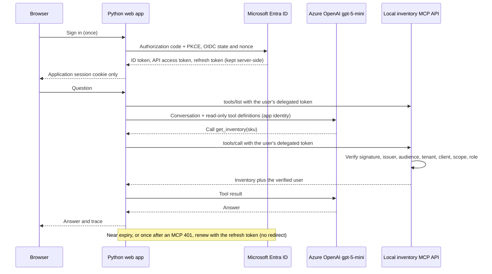

# Inventory chat: sign in once with Microsoft Entra, then just ask

A small Python chat app. You sign in once with **Microsoft Entra ID**, then type
questions and read answers. For each question, `gpt-5-mini` decides whether to
call the inventory tool, and the app calls the MCP server **as you** with a
short-lived delegated access token that it renews server-side. There is no API
key, and the browser never receives an access token or refresh token.

**The web app and MCP server run locally; Entra and the Azure OpenAI deployment
are real.** This does not deploy to AWS or change the APIM, Cognito, Foundry,
or Copilot Studio integrations in the
[M2M walkthrough](../docs/m2m-walkthrough.md).

## Run it

After the one-time [setup](#first-time-setup-or-a-different-environment), run
from the repository root:

```powershell
cd entra-chat-demo
.\run_entra.ps1
```

Open **http://localhost:9102**, select **Sign in**, and start asking. Use the
Microsoft account that ran setup (not the mock's `alice / demo`). Existing
Microsoft SSO usually avoids another password prompt; if the browser has several
signed-in accounts, Entra first shows an account picker. Consent, MFA,
Conditional Access, expired sessions, and revoked access can still require
interaction. Use `localhost`, not `127.0.0.1`: the registered redirect and
cookie host are `localhost`.

The model is called with **your Azure CLI login**. If the launcher warns that
Azure CLI has no token for the tenant, run the `az login --tenant ...` command
it prints and start it again. If you provisioned
[`..\foundry-project`](../foundry-project/README.md) with azd, the launcher reads
the model endpoint from its default azd environment (`AZURE_OPENAI_ENDPOINT` in
`..\foundry-project\.azure\<default environment>\.env`) and uses deployment
`gpt-5-mini`. To use another endpoint or deployment:

```powershell
.\run_entra.ps1 -ModelEndpoint https://<resource>.openai.azure.com -ModelDeployment <deployment>
```

## Using the chat

| In the page | What happens |
| --- | --- |
| Type a question; **Enter** or **Send** (Shift+Enter adds a line) | The model answers, calling `get_inventory` over MCP as you when it needs data |
| Suggestion buttons in an empty chat | Send a ready-made question |
| **Insert a test question…** | Copies one of the 15 prompts from `..\foundry-project\evals\datasets\aws-inventory-agent-turn-tests.jsonl` into the box, for editing before you send |
| Line under each answer (expand for JSON) | Each tool call and its arguments, the user the MCP server verified, any failure, and "token renewed silently" when a renewal happened |
| **New chat** | Clears the conversation; otherwise the model sees the last 20 messages |
| Token countdown and **Delegated access token** | Entra's actual token lifetime and selected decoded claims (a teaching view) |
| **Sign out of this app** / **Sign out of Microsoft** | Clear the local session; the second also redirects to Entra's logout endpoint |

The local MCP server knows one fictional SKU, `WIDGET-001` (42 units in
`ATL-DEMO`); any other SKU returns "Unknown demo SKU". Several dataset prompts
target SKUs or fields, such as `cognitoClientId`, that only the AWS-hosted M2M
path returns, so "unknown" or omitted values are the correct answers here.

## How it works



Two identities stay deliberately separate:

- **Your delegated token goes only to MCP.** Its audience is the inventory API.
  The MCP server validates it on every request and answers as you. A user
  without the `Inventory.Reader` role gets an explained 403 in the chat, and the
  model is not called.
- **The app's identity calls the model.** Locally that is your Azure CLI login
  (`AzureCliCredential`, which needs the *Foundry User* or *Cognitive Services
  OpenAI User* role on the model resource). A deployed app would use a managed
  identity. Your token is never sent to Azure OpenAI, and the model never
  receives any token.

The model sees the conversation, your display name and username (in its system
prompt), the tool definitions, and the tool results, which include your
verified username and tenant/object IDs. It is offered only tools that the MCP
server lists for you and marks read-only, with at most 4 tool rounds and 5 calls
per round for each question. Model failures (no `az login`, a missing role, an
unknown deployment, throttling) appear in the chat as errors, not as answers.

This is **delegated authorization-code OAuth**, not an on-behalf-of exchange.
The access token is issued specifically for the MCP API and is sent only there.
Entra's `sub` is application-specific; use the verified `tid` + `oid` pair for
stable tenant/user identification. Names and usernames are display fields, not
authorization rules.

Optional settings, read from the environment:

| Variable | Default | Meaning |
| --- | --- | --- |
| `AZURE_OPENAI_ENDPOINT` | Discovered by `run_entra.ps1` | `https://<name>.openai.azure.com` (or `.cognitiveservices.azure.com`, `.services.ai.azure.com`), with no path |
| `AZURE_OPENAI_DEPLOYMENT` | `gpt-5-mini` | Chat deployment name |
| `AZURE_OPENAI_TENANT_ID` | The demo's Entra tenant | Tenant for the Azure CLI token |
| `MODEL_REASONING_EFFORT` | `low` | `minimal`, `low`, `medium`, or `high` |
| `TEST_QUESTIONS_FILE` | The eval dataset above | JSONL whose `query` fields fill the picker (first 50) |

Calls use the v1 Chat Completions API (`/openai/v1/chat/completions`) with
function calling. Without a model endpoint, an **offline responder** answers
instead: it looks up up to three SKUs named in the question and reports the
results. It ignores formatting instructions, so the exact-format dataset
prompts need the model.

## First-time setup or a different environment

Requires Windows, PowerShell 7, Python 3.10+, Azure CLI, and an Entra account permitted
to register applications, preauthorize this custom API scope, and assign users
to enterprise applications. Azure subscription Owner alone does not guarantee
these directory permissions. The account running the app also needs access to
an Azure OpenAI chat deployment, as described above.

```powershell
python -m pip install -r requirements.txt
az login
.\setup_entra.ps1 -SubscriptionId <your-subscription-id>
.\run_entra.ps1
```

Setup uses the subscription to select its **Entra tenant**. App registrations
are tenant objects, not resources inside that subscription. The script creates
or reuses dedicated `mcp-chat-demo-api-<subscription-prefix>` and
`mcp-chat-demo-web-<subscription-prefix>` registrations:

- Single-tenant sign-in, v2 API access tokens, and delegated `inventory.read`.
- An `Inventory.Reader` user role, assigned only to the setup account.
- User assignment required on both enterprise applications.
- Only the demo web client preauthorized for that custom API scope.
- Web redirect URIs `http://localhost:9102/auth/callback` and
  `http://localhost:9102/`; implicit token flows stay disabled.
- No Microsoft Graph permissions or Azure resource roles granted to the demo.

Another tenant user cannot use the demo until explicitly assigned to both
enterprise applications (default access on the web app, `Inventory.Reader` on
the API). Do not remove server-side role enforcement to work around a 403.
The server also rejects tokens issued to a different client app.

**There is still a confidential-web-app credential.** It authenticates the web
app to Entra during code redemption/renewal; it is not the old static MCP API
key, and is never sent to MCP. Setup generates a 30-day credential and stores it
with Windows DPAPI in the ignored `.entra\client-secret.xml`. Only the same
Windows user on the same machine can decrypt it. `.entra\config.json` stores
non-secret IDs and the expiry. No plaintext secret is written to source or
printed by the scripts.

```powershell
.\setup_entra.ps1 -SubscriptionId <your-subscription-id> -RotateSecret
```

Rotation replaces only this demo's recorded credential after saving the new
one. Restart the app afterward. Normal setup reuses a valid protected credential.
The launcher puts the credential into its child process environment and restores
the caller's environment afterward. Do not copy `.entra` between users/machines.
For production, use a protected certificate or another supported confidential-
client authentication mechanism, rather than this local demo credential.

## Offline mode and regression checks

`python run_demo.py` (Python 3.10+) runs the same chat offline on ports 9000-9002 with a mock
identity provider: `alice / demo` succeeds, and `bob / demo` lacks the role and
gets an explained 403. Mock tokens last 60 seconds, so silent renewal shows up
in the trace. Answers come from the offline responder unless
`AZURE_OPENAI_ENDPOINT` is set in that shell; the model is then called with
your default `az login` tenant, or `AZURE_OPENAI_TENANT_ID`. The Entra launcher
uses 9101-9102, never starts the mock, and does not fall back to it if Entra is
misconfigured. The two modes can run side by side.

Run checks in a separate shell with no Entra environment:

```powershell
python -m unittest -v test_entra test_chat
$env:IDP_PORT="9200"; $env:MCP_PORT="9201"; $env:WEB_PORT="9202"
python test_flow.py
```

`test_entra` covers Entra-shaped signed JWTs and error paths. `test_chat` covers
the tool loop, read-only tool filtering, renewal after an MCP 401, model error
handling, and the chat routes with a fake model. `test_flow.py` drives the mock
end to end through the chat with the offline responder: PKCE sign-in,
server-side token storage, CSRF protection, answers, transcript persistence,
token rotation, rejected tokens, both sign-outs, and the role-based 403. None of
them contact Entra or Azure OpenAI, so they do not replace a real sign-in.

## Deploy to Azure with azd

This deploys the chat app on its own. To deploy it together with the M2M gateway
and the Foundry project, run `azd up` from the repository root instead (see the
[root README](../README.md#deploy-everything-with-one-azd-up)). That deployment
reuses these Bicep modules and uses root-level pre/postprovision hooks for Entra,
authenticated as the signed-in `az` user. Both create registrations with the same
display names, so use a different azd environment name for each.

Prerequisites: [azd](https://aka.ms/azd), Azure CLI, PowerShell 7+, and an Entra
account that can register applications and create Azure resources.

```powershell
az login
azd auth login          # azd and az keep separate sign-ins; the hooks use az
cd entra-chat-demo
azd up
```

`azd up` runs three hooks around provisioning and deployment:

1. **preprovision** creates two single-tenant app registrations (API and web), assigns
   you the demo role, and stores the tenant, client IDs and a 90-day client secret
   in the azd environment (`.azure/<env>/.env`, git-ignored, plain text).
2. Bicep creates the resource group, Container App, container registry (image built
   in Azure, no local Docker), Log Analytics, a managed identity, and an Azure OpenAI
   account with a `gpt-5-mini` deployment. The app calls the model with its managed
   identity; no keys.
3. **postprovision** registers `<app URL>/auth/callback` as the redirect URI.

Then open the printed URL and sign in. Add other users in the Entra portal under
Enterprise applications > the web app > Users and groups.

Options (`azd env set <NAME> <value>`, then `azd provision`):

- `EXISTING_OPENAI_RESOURCE_ID`: reuse an Azure OpenAI/Foundry account instead of
  creating one. Its deployment (`AZURE_OPENAI_DEPLOYMENT`, default `gpt-5-mini`) must exist.
- Pick a region with `gpt-5-mini` GlobalStandard quota (30K TPM by default).

Notes:

- **Cost:** one always-on replica (0.5 vCPU, 1 GiB), ACR Basic, Log Analytics, and model usage.
- **One replica only:** sessions and tokens are in memory and are lost on restart.
- **Secret rotation:** re-run `azd provision` within 14 days of expiry to issue a new one.
- **Cleanup:** `azd down --purge` removes the Azure resources (and frees the soft-deleted
  OpenAI account); the postdown hook deletes the two app registrations.
- If ACR Tasks is blocked on your subscription, set `remoteBuild: false` in `azure.yaml`
  and install Docker.

## Files and boundaries

| File | Purpose |
| --- | --- |
| `setup_entra.ps1` | Narrowly scoped Entra registration, assignment, and protected credential setup |
| `run_entra.ps1` | Loads the protected configuration, finds the model, and runs the live Entra variant |
| `config.py` | Explicit mock/Entra modes and validated model settings |
| `webapp.py` | Authlib code + PKCE sign-in, token renewal, session/CSRF handling, chat routes and page |
| `chat.py` | MCP client that calls as the user, Azure OpenAI tool loop, offline responder |
| `mcp_server.py` | JWT validation, per-user authorization, protected-resource metadata |
| `run_demo.py` | Local web/API hosting; mock IdP only in mock mode |
| `serve.py` | Production entrypoint (waitress) used by the container image |
| `azure.yaml`, `Dockerfile`, `Dockerfile.dockerignore` | azd project and image for Azure Container Apps (build context is the repository root) |
| `infra/` | Bicep (Container App, ACR, Log Analytics, managed identity, Azure OpenAI) and the pwsh hooks that manage the Entra registrations |
| `idp_mock.py` | Offline teaching provider, never a replacement for Entra in live mode |
| `test_entra.py`, `test_chat.py`, `test_flow.py` | Local regression and mock end-to-end checks |

The demo uses loopback HTTP and a single-process, in-memory store for tokens and
chats. App sessions last at most eight hours, keep the last 20 chat messages,
answer one question at a time, and disappear on sign-out or restart. It is not a
production web host or durable multi-user session service. Use HTTPS, protected
shared session/token storage, credential rotation, and an appropriate production
server when deploying. Never log raw tokens, credentials, or authorization-code
callback query strings.

Token endpoint outages produce an error without discarding the refresh token.
Revocation or an interaction-required response asks the user to sign in again.
The inventory data is fictional, and model answers can be wrong; the trace shows
what the tool actually returned. A production UI would hide the claim display.

## Mapping this back to the gateway and agent platforms

Here `chat.py` plays the agent's part: it runs the model's tool loop and
attaches the signed-in user's token to MCP calls. In Foundry or Copilot Studio
the platform runs that loop, and the equivalent decision is how, or whether, it
passes the user's identity to the MCP tool.

The M2M sample's [`..\m2m-gateway\server.mjs`](../m2m-gateway/server.mjs) accepts
**Cognito** tokens; it will not accept this demo's Entra token without changing
its resource-server validation. Likewise, the M2M walkthrough's APIM routes and
shared-key connection are unaffected by this demo.

For an Entra-backed variant, add a separately authorized APIM route that does
not require a subscription key, validates the token's intended API audience,
tenant, delegated scope, and role, and forwards that same API's token to its
backend. Both gateway and backend must agree on that API identity. Do not
forward an API token to a different downstream audience: use a supported
on-behalf-of/token-exchange flow or a separate workload identity there.

Foundry's Entra user-delegation and OAuth identity-passthrough options are
different integration choices; this standalone client does not exercise either
agent platform. Copilot Studio support must be confirmed for the specific
harness and published channel. Native Entra SSO can reduce prompts, but adding
OAuth alone does not guarantee zero consent or MFA prompts.

To remove this demo later, use the application IDs in `.entra\config.json` to
delete only these two dedicated app registrations and their assignments.
Deleting the Azure resource group does not delete these tenant-level objects.

References:
[Entra authorization-code flow](https://learn.microsoft.com/en-us/entra/identity-platform/v2-oauth2-auth-code-flow),
[OIDC and logout](https://learn.microsoft.com/en-us/entra/identity-platform/v2-protocols-oidc),
[API scopes and preauthorization](https://learn.microsoft.com/en-us/graph/api/resources/apiapplication),
[access-token validation](https://learn.microsoft.com/en-us/entra/identity-platform/access-tokens),
[Azure OpenAI v1 API](https://learn.microsoft.com/en-us/azure/foundry/openai/api-version-lifecycle),
[function calling](https://learn.microsoft.com/en-us/azure/foundry/openai/how-to/function-calling).
